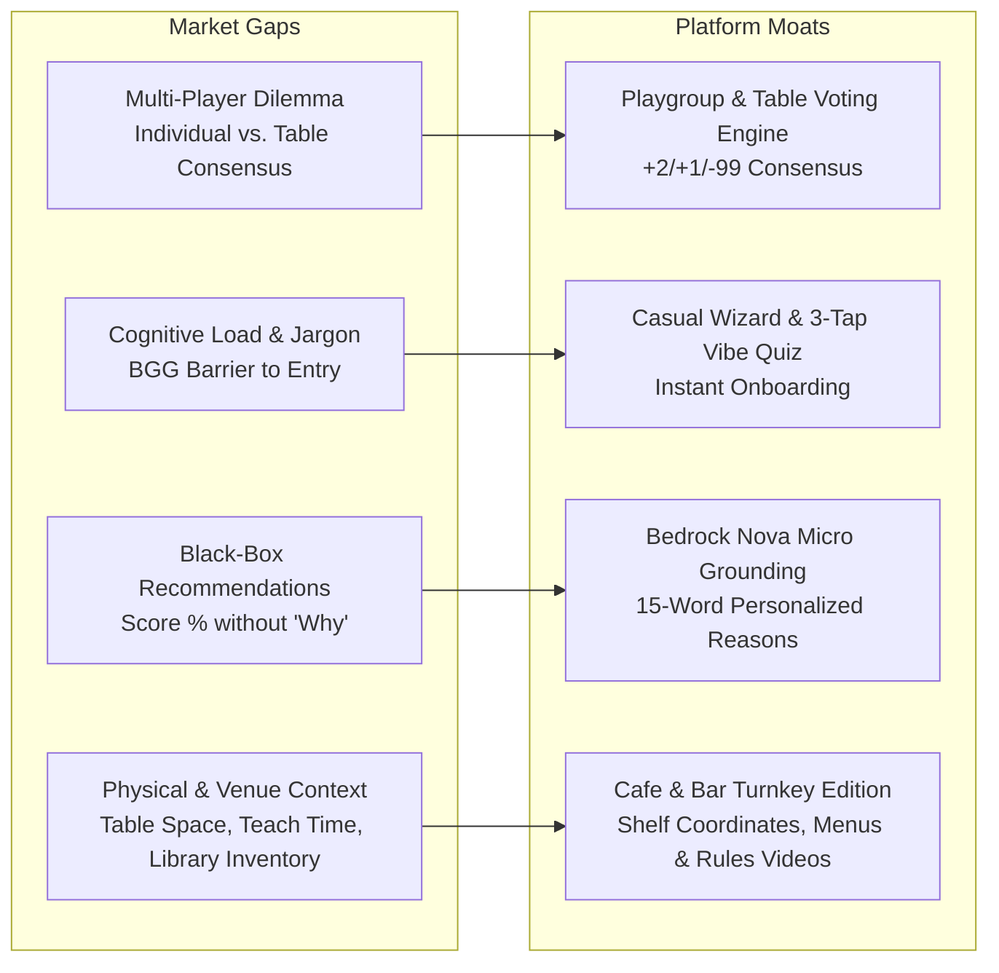

# Board Game Recommendation Landscape: Market Opportunities & Strategic Analysis

## Executive Summary

The digital board game recommendation landscape is fragmented across specialized niches: algorithmic engines, psychometric profilers, collection utility tools, visual similarity maps, and commercial price aggregators. 

While existing platforms excel in single-user statistical modeling or static catalog curation, they almost universally suffer from **four critical industry blind spots**:
1. **The Multiplayer Consensus Gap:** Board gaming is inherently social, yet existing engines treat recommendations as an isolated single-player activity.
2. **The "BGG Jargon & Cold Start" Barrier:** Over-reliance on existing BoardGameGeek accounts and complex hobbyist taxonomies alienates casual and gateway players.
3. **Black-Box Opacity vs. Warm Explainability:** Mathematical recommendation scores lack conversational justification, leaving users wondering *why* a game was chosen.
4. **Disconnection from Physical Context:** Traditional recommenders ignore physical table space, teach complexity, component availability, and venue physical realities.

The **Boardgame Recommender** platform has already established core technical moats—specifically its cloud-native serverless architecture, Bedrock LLM narration, group session voting, and turnkey **Cafe & Bar Edition**. This document analyzes the competitive ecosystem, details where others succeed, and outlines high-leverage market opportunities to expand this platform into the premier discovery engine for both individual gamers and social venues.

---

## 1. Competitive Landscape Matrix

```mermaid
quadrantChart
    title Tabletop Discovery Ecosystem: Personalization vs. Physical / Social Context
    x-axis Low Physical/Social Context --> High Physical/Social Context (Venue, Group, Table)
    y-axis Low Personalization / Static Filters --> High Algorithmic Personalization
    quadrant-1 "Turnkey Social & Venue Discovery (Boardgame Recommender Opportunity)"
    quadrant-2 "Algorithmic Specialists (Isolated Player)"
    quadrant-3 "Curators & Deal Trackers"
    quadrant-4 "Collection Utilities & Menus"
    "Recommend.Games": [0.25, 0.88]
    "TryTheseGames": [0.18, 0.82]
    "Quantic Foundry": [0.12, 0.72]
    "BGG 'Fans Also Like'": [0.30, 0.45]
    "BoardGameGeek Search": [0.15, 0.32]
    "Shut Up & Sit Down": [0.38, 0.35]
    "Board Game Oracle": [0.22, 0.22]
    "Board Game Menu": [0.72, 0.28]
    "Board Game Helpers": [0.65, 0.40]
    "Interactive Similarity Map": [0.20, 0.58]
    "Boardgame Recommender (Current)": [0.82, 0.85]
```

### Comparative Analysis of Key Competitors

| Platform / Tool | Core Methodology | Primary Strengths (Where They Succeed) | Critical Weaknesses (Where They Fall Short) |
|---|---|---|---|
| **[Recommend.Games](https://recommend.games)** | Collaborative filtering (Matrix Factorization via Turi Create) trained on BGG ratings | • High statistical accuracy across deep BGG collections<br>• Custom "R.G. Ranking" debiases BGG hype, age, and complexity<br>• Clean, responsive UI | • Black-box scoring with no conversational explanation<br>• Hard cold-start for non-BGG users<br>• No group consensus or session tools<br>• No physical availability or venue context |
| **[TryTheseGames](https://trythesegames.com)** | Bayesian ratings contrast model + content priors (Royal Statistical Society) | • Exceptional at identifying non-obvious cult classics matching a seed game<br>• Mitigates popularity bias mathematically | • Single-seed input only (cannot build a holistic profile)<br>• Dated static web presentation<br>• No multi-player or group synthesis |
| **[Quantic Foundry](https://apps.quanticfoundry.com/)** | Psychometric survey (11 motivations in 4 clusters: Strategy, Conflict, Immersion, Social) | • Bridges the vocabulary gap: focuses on *psychological enjoyment* rather than jargon<br>• High engagement and viral shareability | • Static snapshot: not connected to active game libraries or collections<br>• Lengthy initial questionnaire required<br>• No table or group resolution |
| **[BoardGameGeek Native](https://boardgamegeek.com)** | Crowdsourced relational database, "Fans Also Like", GeekLists, GeekBuddies | • Unrivaled ground-truth catalog, community rating volume, and historical depth | • Overwhelming, dated UI and high friction for casual players<br>• "Fans Also Like" is rudimentary and skewed toward top-ranked games<br>• No automated AI reasoning |
| **[Shut Up & Sit Down](https://www.shutupandsitdown.com/)** | Editorial curation, personal lists, and "Find-Me-A-Game-O-Matic" | • High community trust, humor, charisma, and evocative qualitative writing | • Limited to games personally reviewed by the team<br>• No algorithmic personalization or user taste modeling |
| **[Board Game Oracle](https://www.boardgameoracle.com/)** | Retail pricing scraper, historical price drops, influencer top 100s | • Unbeatable conversion from discovery to purchase<br>• Tracks deals, stock, and historical lows | • No recommendation intelligence (relies on external critic lists or raw BGG rank) |
| **[Board Game Helpers / Menu](https://boardgame.menu)** | BGG collection sync filtered by player count, duration, weight; course-style menus | • Fun, accessible tabletop presentation for game nights<br>• Focuses on games actually owned | • Superficial filtering rather than taste-based scoring<br>• No adaptive learning or AI narrative |
| **Interactive Similarity Map** | Graph clustering (2D galaxy projection) of 40k games based on review correlations | • Visually mesmerizing serendipitous exploration<br>• Visualizes sub-genre clusters naturally | • Zero mobile usability<br>• High cognitive load; doesn't answer "what should we play right now?" |

---

## 2. Deep Dive: Where Competitors Succeed

Understanding what existing platforms do well provides clear architectural blueprints for adoption:

### 1. Statistical Debiasing (Recommend.Games)
Raw BGG data has known structural pathologies:
- **Kickstarter / Recency Hype:** New, lavishly produced games receive artificially inflated 10/10 early backer ratings.
- **Complexity Bias:** Heavy 4.0+ weight games dominate top ranks because casual players self-select out, leaving only enthusiasts to vote.
- **Nostalgia / Age Decay:** Older titles (e.g., classic Eurogames) get demoted over time as newer hype titles enter.
Recommend.Games succeeded by constructing its own debiased leaderboard. *Boardgame-Recommender's recent Milestone 61 (Gaussian complexity decay) and Milestone 62 (TF-IDF catalog frequency discounting) address this, but further tuning can be applied.*

### 2. Ratings Contrast vs. Global Popularity (TryTheseGames)
TryTheseGames proved that simply recommending games that "similar users like" yields generic results (e.g. recommending *Pandemic* and *Terraforming Mars* to everyone). By measuring **differential contrast**—games that lovers of Game X rate substantially higher than the global baseline—they consistently unearth niche gems.

### 3. Psychological Motivations (Quantic Foundry)
Quantic Foundry identified that many players don't know what "worker placement" or "variable player powers" means. Instead, they know whether they enjoy:
- **Direct Confrontation** (attacking neighbors vs. multiplayer solitaire)
- **Social Deception / Table Talk** (bluffing, negotiating, deducing)
- **Aesthetic / Tactile Immersion** (beautiful miniatures, rich narrative themes)
- **Mastery / Long-term Strategy** (calculating 3 turns ahead without luck)
Translating mechanics into player sensations is where recommendation engines win mainstream adoption.

---

## 3. Market Gaps: Where Others Fail & Opportunities for This Project



### Gap 1: The Multi-User "Game Night / Table Vibe" Dilemma
* **The Reality:** Unlike streaming video or audio where consumption is solo, 95% of board game experiences are shared. Recommending a heavy, brain-burning game because the host likes it will ruin the night if two guests are exhausted after work.
* **Competitor Blind Spot:** No major recommendation engine natively supports multi-user profiles with weighted compromise and anti-veto protection.
* **Our Advantage:** We have [Playgroup Organizer](file:///c:/Git/Boardgame-Recommender/site_ui/groups/index.html) and [Async Table Voting Sessions](file:///c:/Git/Boardgame-Recommender/site_ui/vote/index.html). Expanding this into a zero-friction, QR-sharable "Instant Table Vibe" is a major market opportunity.

### Gap 2: Physical Venue Operations (Turnkey Cafe & Bar Edition)
* **The Reality:** Board game cafes and hobby lounges have hundreds of games on shelves, but floor staff spend an unsustainable amount of time walking tables asking: *"How many players? How long do you have? What have you played before?"* Patrons often give up and play something familiar like *Connect 4* or *Jenga*.
* **Competitor Blind Spot:** Not a single major recommendation platform offers a white-label or turnkey venue edition that maps to physical shelf coordinates (`Shelf: B-3`), filters by table surface area, links to rules videos, and connects to food/drink menus.
* **Our Advantage:** Our completed **Cafe & Bar Edition** ([cafe_roadmap.md](file:///c:/Git/Boardgame-Recommender/cafe_roadmap.md)) is uniquely positioned to dominate this B2B / B2B2C space.

### Gap 3: Conversational Explainability & "The Sommelier Effect"
* **The Reality:** A cold recommendation that says *"Recommended: Concordia (Score: 84.2%)"* fails to build anticipation or trust. Players want to know: *"Why should we play this tonight?"*
* **Competitor Blind Spot:** Traditional algorithms cannot provide qualitative reasoning without expensive manual editorial staff.
* **Our Advantage:** Our integration with [Amazon Bedrock Nova Micro](file:///c:/Git/Boardgame-Recommender/bgg_recommender/narration.py) delivers punchy, grounded 15-word justifications rotating across 7 analytical lenses (tactility, table talk, strategic tension, pacing).

### Gap 4: Natural Language "Mood / Vibe" Discovery
* **The Reality:** Modern users don't want to fiddle with 12 slider inputs (weight: 2.7–3.4, year: 2018–2024, mechanics: Hand Management). They want to type: *"A fast, high-interaction 3-player game with beautiful art that doesn't feel mean and takes under an hour."*
* **Competitor Blind Spot:** Existing tools rely almost exclusively on strict SQL-like faceted filters or pure collaborative filtering IDs.

---

## 4. Strategic Recommendations for Boardgame-Recommender

To capitalize on these market openings, here are concrete, prioritized recommendations for upcoming platform development:

### Opportunity A: The "Instant Table Sync" (Frictionless Group Guest Join)
* **Concept:** Allow a game night host or cafe table leader to generate a dynamic 4-character join code or QR code (`app.com/table/JOIN`). Up to 6 friends can scan with their phone camera, answer 2 quick vibe questions (or link their BGG handle if they have one), and the recommender computes an instant **Pareto-Optimal Compromise List** with negative veto weights (-99) on despised mechanics.
* **Technical Effort:** Low-Medium. Reuses existing `bgg-game-night-sessions` DynamoDB table and `sessions.py` consensus scoring logic.

### Opportunity B: Natural Language "Vibe Search" via Bedrock Vector Embeddings
* **Concept:** Add a conversational search bar on the homepage: *"What kind of game night are you craving?"* Convert the user's natural language description into an embedding (or extract structured filter criteria via Bedrock) to search against the Snappy Parquet catalog.
* **Value:** Completely bypasses BGG jargon, capturing the casual and party game audience who don't know the difference between "Worker Placement" and "Deck Building."

### Opportunity C: Commercial Venue Expansion (The "Digital Game Guru")
* **Concept:** Further monetize or expand the [Cafe Edition](file:///c:/Git/Boardgame-Recommender/site_ui/cafe/index.html):
  1. **Game Night Flight / Tasting Menu:** Generate a structured 3-stage game night recommendation:
     - *Starter / Warmup:* 15-min light card game (e.g. *Scout* or *Just One*)
     - *Main Course:* 60-min centerpiece game (e.g. *Cascadia* or *Wingspan*)
     - *Dessert / Wind-down:* 20-min push-your-luck / laughter game (e.g. *Camel Up*)
  2. **Affiliate / Local Retailer Bridge ("Buy This Game"):** When a patron finishes playing a game at a cafe or loves a recommendation, provide a 1-tap price comparison link powered by Board Game Oracle or local store inventory.

### Opportunity D: Milestone 31 (Similar Games / "More Like This") & Milestone 46 (Score Inspector)
* **Next Implementation Steps:** The roadmap already details two highly impactful features waiting for implementation:
  - [Milestone 31: Similar Games API Endpoint](file:///c:/Git/Boardgame-Recommender/project_roadmap.md#L24-L46): Provides an instant, profile-free content lookup (`GET /similar?game_id=...`) based on Jaccard mechanics/categories overlap. Directly competes with TryTheseGames without the cold-start barrier.
  - [Milestone 46: Game Score Inspector](file:///c:/Git/Boardgame-Recommender/project_roadmap.md#L49-L73): Solves algorithmic transparency ("Why wasn't Gloomhaven recommended?") by breaking down per-dimension scores and filter exclusion reasons.

---

## 5. Architectural Comparison & Feature Scorecard

| Feature Dimension | Recommend.Games | TryTheseGames | Quantic Foundry | BGG Native | Board Game Oracle | **Boardgame Recommender** |
|---|:---:|:---:|:---:|:---:|:---:|:---:|
| **Personalized Taste Modeling** | ⭐⭐⭐⭐⭐ | ⭐⭐⭐ | ⭐⭐⭐⭐ | ⭐⭐ | ❌ | **⭐⭐⭐⭐⭐** (TF-IDF + Cosine) |
| **Explainable AI Reasoning** | ❌ | ⭐ | ❌ | ❌ | ❌ | **⭐⭐⭐⭐⭐** (Bedrock Nova Micro) |
| **Multiplayer / Group Consensus**| ❌ | ❌ | ❌ | ❌ | ❌ | **⭐⭐⭐⭐⭐** (Playgroups & Sessions) |
| **Zero-BGG Cold Start** | ⭐⭐⭐ | ⭐⭐⭐⭐ | ⭐⭐⭐ | ⭐ | ⭐⭐⭐⭐⭐ | **⭐⭐⭐⭐⭐** (2-Round Wizard + Autocomplete) |
| **Venue / Cafe Turnkey Features** | ❌ | ❌ | ❌ | ❌ | ❌ | **⭐⭐⭐⭐⭐** (Shelf, QR, Wi-Fi, Menus) |
| **Media & Rules Integration** | ❌ | ❌ | ❌ | ⭐⭐⭐ | ❌ | **⭐⭐⭐⭐** ("Watch It Played" Ingestion) |
| **Price & Availability Tracking**| ❌ | ❌ | ❌ | ⭐ | ⭐⭐⭐⭐⭐ | ❌ *(Strategic Opportunity)* |
| **Serverless Operational Cost** | N/A (Dedicated VM)| N/A | N/A | Enterprise | Enterprise | **⭐⭐⭐⭐⭐** (AWS S3 + Lambda + Parquet) |

---

## 6. Summary of Actionable Next Steps

1. **Prioritize Milestone 31 ("Similar Games API"):** Unlocks instant game-to-game discovery for users browsing the catalog without requiring login.
2. **Implement "Game Flight / Tasting Menu" for Cafe Edition:** Differentiate from all competitors by recommending sequenced game courses (Warm-up $\rightarrow$ Main $\rightarrow$ Dessert).
3. **Add Frictionless Table QR Sessions:** Eliminate the need for all group members to sign in by supporting anonymous guest voting on active table recommendations.
4. **Partner or Link with Deal Aggregators:** Integrate Board Game Oracle affiliate or price tracking links on game detail cards to capture purchase intent.
